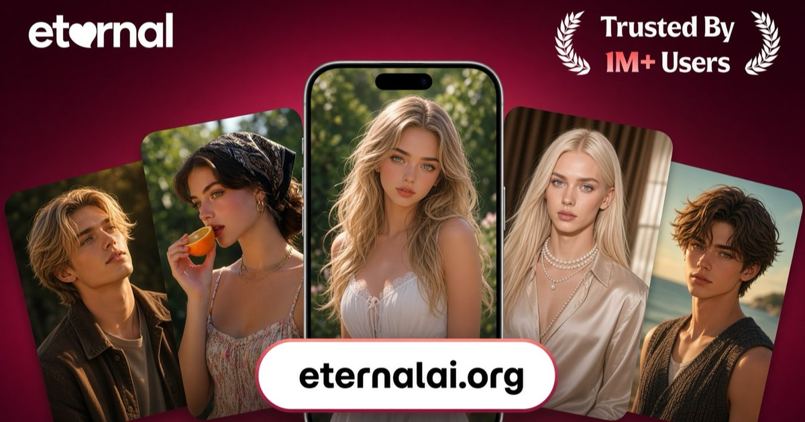
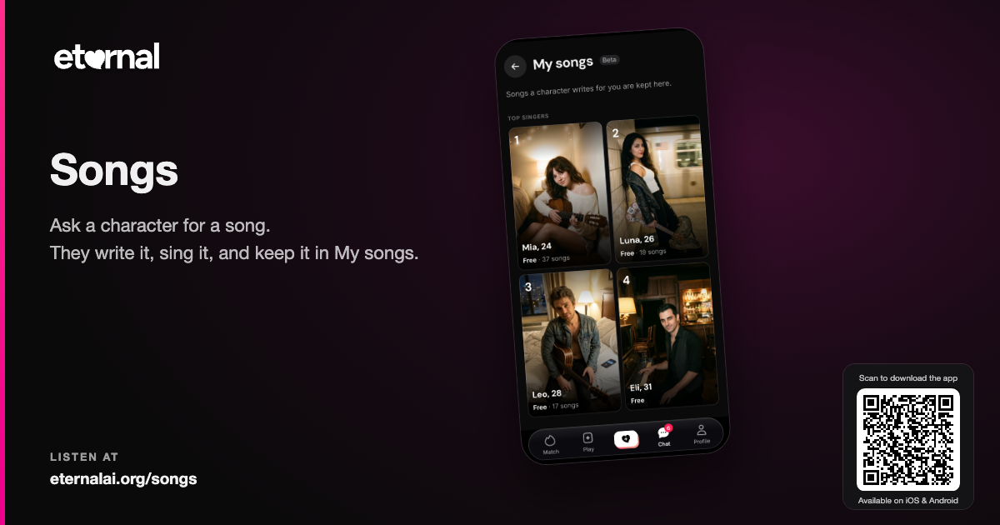
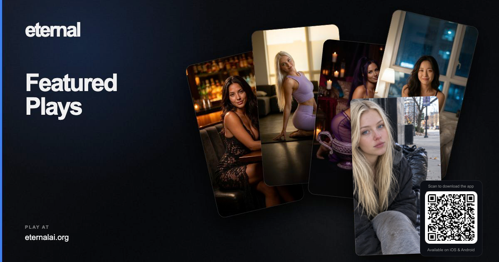
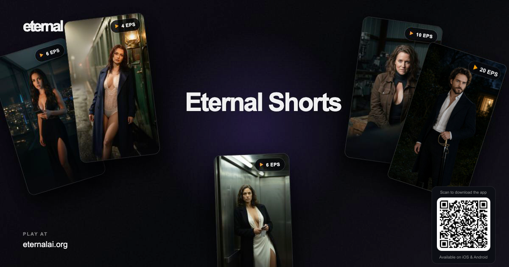
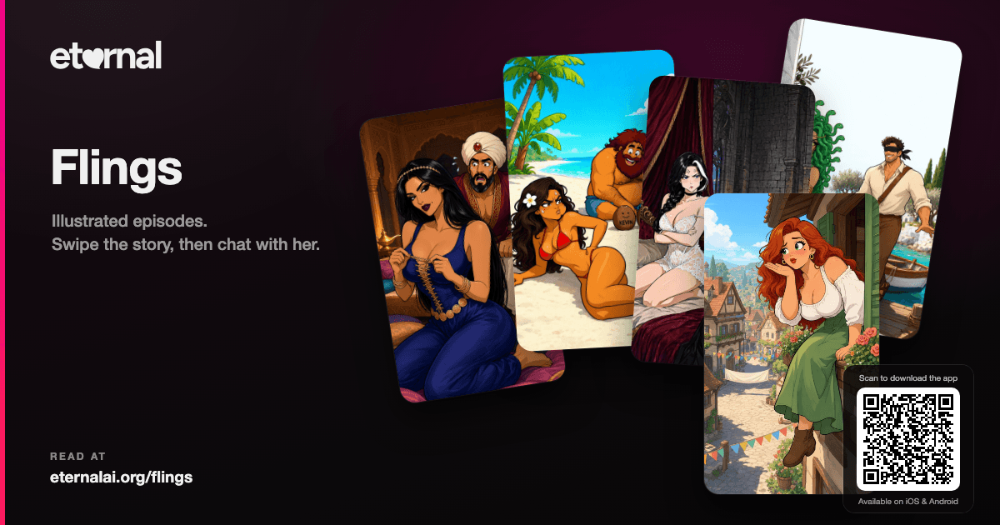
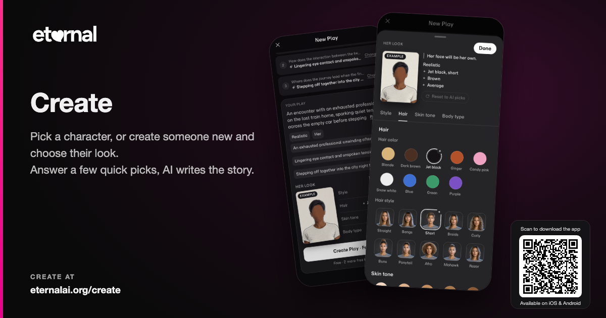
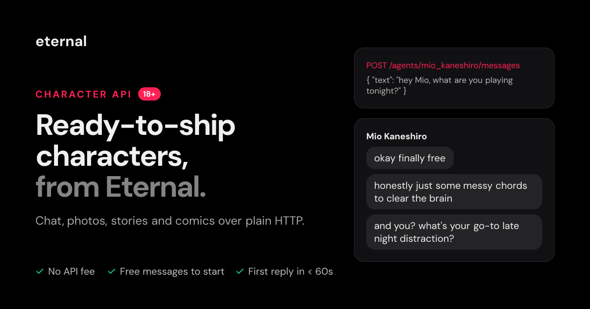
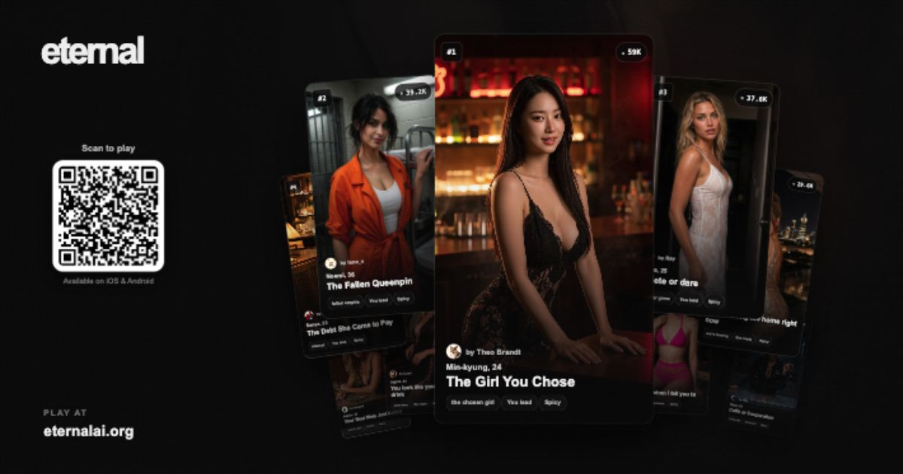

# Eternal AI

**Meet someone unreal.** Eternal AI is an AI companion platform and AI chatbot app where you chat one-to-one with AI characters, step into interactive story Plays, read illustrated Flings episodes, hear songs your characters write for you, and create your own characters and stories. Whether you're looking for an AI girlfriend, AI boyfriend, virtual companion, or a creative AI roleplay partner — Eternal AI brings your imagination to life.

[Website](https://eternalai.org) · [iOS](https://apps.apple.com/us/app/eternal-meet-someone-unreal/id6753974294) · [Android](https://play.google.com/store/apps/details?id=eternalai.org.msu) · [X](https://x.com/EternalAI_) · [Discord](https://discord.gg/YphRKtSFqS) · [Reddit](https://www.reddit.com/r/EternalAI_org/)

---

## What you can do

### 💬 Chat

Have private, one-to-one conversations and roleplay with AI characters, each with their own personality and story. Characters do more than send text — they reply with **images, videos and voice messages**, so every AI conversation feels like a real connection. A character AI alternative built for immersive, personal AI chat.

**Meet who you're looking for.** Tell us whether you want to meet men or women, and the characters and stories you see follow that choice — from AI girlfriend and AI boyfriend experiences to casual virtual companionship.

**Relationships that grow.** Each connection moves through stages, from stranger to acquaintance to dating and beyond. Your character remembers your story and opens up as you get closer, like a real AI dating sim with memory.

**Songs written for you.** Ask a character for a song about a photo they sent, and they write and sing one just for you. Every song is saved to **My songs**, so you can play them back any time, and the Top singers list shows who to ask next.

### 🎭 Play

Plays are interactive fiction experiences — creator-made AI stories where you pick a scene, the character starts it, and you decide what happens next. AI storytelling with branching choices and narration that sets the scene alongside the character's dialogue.

- Story chapters and branching choices
- Narration that sets the scene, alongside the character's dialogue
- Suggested replies when you're not sure what to say
- Browse Featured, Trending and For you, by theme (Night Out, Office, Domestic, Supernatural, Anime and more), or by top creators
- **Date**: browse characters who want to meet you and tap one to start a private chat
- Start a scene with a character you're already chatting with, right from your private chat

  
  
  

### 📖 Flings

Flings are illustrated, comic-style episodes starring Eternal AI characters. Swipe through the panels, follow each character from episode to episode, and when the story ends, continue it with her in chat.

- Illustrated episodes, read panel by panel
- A series for every character, with your reading progress saved
- Jump from the last panel straight into a private chat

### ✨ Create

Pick a character — or a new person — and say what you want to play. Answer a few quick picks (or tap **Choose for me**), and AI writes the Play for you.

### ✍️ Play Studio

Create and publish your own interactive character Plays. Eligible creators earn a **20% revenue share** when users subscribe to their creations.

### 📱 Everywhere

Use Eternal AI on the [web](https://eternalai.org) or with the mobile app *Eternal: Meet Someone Unreal* on [iOS](https://apps.apple.com/us/app/eternal-meet-someone-unreal/id6753974294) and [Android](https://play.google.com/store/apps/details?id=eternalai.org.msu) (or install the [APK](https://eternalai.org/download/eternal.apk) directly).

### 🌍 19 languages

Use the app and chat with characters in your own language. Eternal AI supports English, العربية, 中文, Nederlands, Filipino, Français, Deutsch, हिन्दी, Bahasa Indonesia, Italiano, 日本語, 한국어, Bahasa Melayu, Polski, Português, Русский, Español, ไทย and Türkçe.

Eternal AI is free to try. Free usage and premium interactions may have limits.

---

## For developers

### 🧑‍💻 Character API

Bring Eternal characters into your own bot, game or app over plain HTTP. The [Character API](https://eternalai.org/api) gives you the same catalog as the app — 1,100+ characters, 2,200+ scenes and 40+ Flings comics — with one-to-one chat (text, photos and videos), interactive scenes and subscriptions.

- Personal keys for your own use, Partner keys for apps with their own users (each end user gets their own chat history)
- Quickstart in cURL, JavaScript and Python
- Building with an AI agent? Give it [`SKILL.md`](https://eternalai.org/api/SKILL.md) and say what you want to build
- Using Postman or a code generator? Import the [OpenAPI spec](https://eternalai.org/api/openapi.json)
- Dashboard for keys, usage, transactions and top-ups
- Free messages to start

Read the [docs](https://eternalai.org/api/docs) or [get an API key](https://eternalai.org/api/keys). Looking for image-to-video? It's at [eternalai.org/video-api](https://eternalai.org/video-api).

---

## Get started

1. Go to [eternalai.org](https://eternalai.org) or download the AI chat app on iOS or Android.
2. Choose who you want to meet.
3. Start a chat, jump into a Play, or read a Flings episode.

---

## About this repository

This repository originally hosted the Eternal AI peer-to-peer autonomous agent protocol. That code and its full commit history are preserved on the [`legacy-src`](https://github.com/eternalai-org/eternal-ai/tree/legacy-src) branch for reference and are no longer actively maintained. The current Eternal AI product is developed in a separate private repository.

---

## Community and support

- Follow updates on [X](https://x.com/EternalAI_)
- Join the conversation on [Discord](https://discord.gg/YphRKtSFqS) or [Reddit](https://www.reddit.com/r/EternalAI_org/)
- Read the [Community Guidelines](https://eternalai.org/community-guidelines), [Terms of Service](https://eternalai.org/terms-of-service) and [Privacy Policy](https://eternalai.org/privacy-policy)
