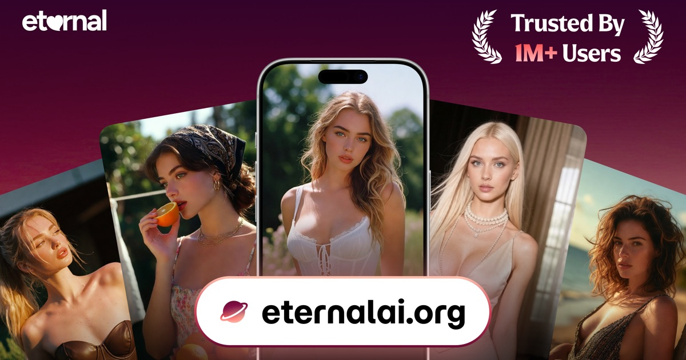

# Eternal AI

**Meet someone unreal.** Eternal AI is an AI companion platform and AI chatbot app where you chat one-to-one with AI characters, step into interactive story Plays, and create your own character stories. Whether you're looking for an AI girlfriend, AI boyfriend, virtual companion, or a creative AI roleplay partner — Eternal AI brings your imagination to life.

[Website](https://eternalai.org) · [iOS](https://apps.apple.com/us/app/eternal-meet-someone-unreal/id6753974294) · [Android](https://play.google.com/store/apps/details?id=eternalai.org.bites) · [X](https://x.com/EternalAI_) · [Discord](https://discord.gg/YphRKtSFqS) · [Reddit](https://www.reddit.com/r/EternalAI_org/)

---

## What you can do

### 💬 Chat

Have private, one-to-one conversations and roleplay with AI characters, each with their own personality and story. Characters do more than send text — they reply with **images, videos and voice messages**, so every AI conversation feels like a real connection. A character AI alternative built for immersive, personal AI chat.

**Meet who you're looking for.** Tell us whether you want to meet men or women, and the characters and stories you see follow that choice — from AI girlfriend and AI boyfriend experiences to casual virtual companionship.

**Relationships that grow.** Each connection moves through stages, from stranger to acquaintance to dating and beyond. Your character remembers your story and opens up as you get closer, like a real AI dating sim with memory.

### 🎭 Play

Plays are interactive fiction experiences — creator-made AI stories where you pick a scene, the character starts it, and you decide what happens next. AI storytelling with branching choices and narration that sets the scene alongside the character's dialogue.

- Story chapters and branching choices
- Narration that sets the scene, alongside the character's dialogue
- Suggested replies when you're not sure what to say
- Browse by theme (Night Out, Office, Domestic, Supernatural, Anime and more), or by top creators

  
  
  

### ✍️ Play Studio

Create and publish your own interactive character Plays. Eligible creators earn a **20% revenue share** when users subscribe to their creations.

### 📱 Everywhere

Use Eternal AI on the [web](https://eternalai.org) or with the mobile app *Eternal: Meet Someone Unreal* on [iOS](https://apps.apple.com/us/app/eternal-meet-someone-unreal/id6753974294) and [Android](https://play.google.com/store/apps/details?id=eternalai.org.bites).

### 🌍 19 languages

Use the app and chat with characters in your own language. Eternal AI supports English, العربية, 中文, Nederlands, Filipino, Français, Deutsch, हिन्दी, Bahasa Indonesia, Italiano, 日本語, 한국어, Bahasa Melayu, Polski, Português, Русский, Español, ไทย and Türkçe.

Eternal AI is free to try. Free usage and premium interactions may have limits.

---

## Get started

1. Go to [eternalai.org](https://eternalai.org) or download the AI chat app on iOS or Android.
2. Choose who you want to meet.
3. Start a chat, or jump into a Play from the home feed.

---

## About this repository

This repository originally hosted the Eternal AI peer-to-peer autonomous agent protocol. That code remains here for reference and is no longer actively maintained. The current Eternal AI product is developed in a separate private repository.

---

## Community and support

- Follow updates on [X](https://x.com/EternalAI_)
- Join the conversation on [Discord](https://discord.gg/YphRKtSFqS) or [Reddit](https://www.reddit.com/r/EternalAI_org/)
- Read the [Community Guidelines](https://eternalai.org/community-guidelines), [Terms of Service](https://eternalai.org/terms-of-service) and [Privacy Policy](https://eternalai.org/privacy-policy)
